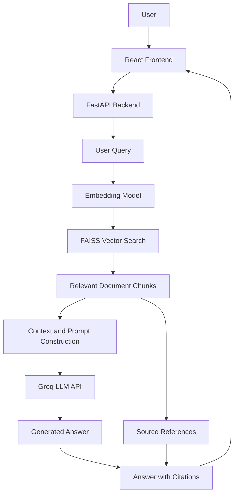

# 🧠 DocuMind — Enterprise RAG-Based AI Knowledge Assistant

An AI-powered document question-answering application that enables users to interact with organizational documents using natural language.

Built using **Retrieval-Augmented Generation (RAG)**, semantic search, vector embeddings, and Large Language Models (LLMs).

🌐 **Live Demo:** [Try DocuMind](https://documind-alq.pages.dev/)

⚙️ **Backend API:** [Render API](https://documind-api-uu9t.onrender.com/)

📡 **API Health:** [Health Check](https://documind-api-uu9t.onrender.com/api/health)

---

## 📌 Overview

DocuMind is an AI-powered knowledge assistant designed to retrieve relevant information from documents and generate context-aware answers.

Instead of manually searching through lengthy documents, users can ask questions in natural language and receive answers supported by document-based source citations.

The application uses a Retrieval-Augmented Generation (RAG) pipeline to improve answer relevance and reduce unsupported responses.

## ✨ Key Features

- 📄 **Document Processing:** Extracts and processes text from PDF documents.
- 🔍 **Semantic Search:** Retrieves relevant document content using vector embeddings.
- 🧠 **RAG Pipeline:** Combines document retrieval with LLM-based answer generation.
- 💬 **Natural Language Q&A:** Allows users to ask questions about indexed documents.
- 📚 **Source Citations:** Provides document references supporting generated answers.
- 🛡️ **Grounded Responses:** Uses retrieval relevance checks to handle unsupported questions.
- ⚡ **Vector Similarity Search:** Uses FAISS for similarity-based retrieval.
- 🔄 **Conversation Management:** Supports creating chat sessions.
- ☁️ **Cloud Deployment:** Independently deployed frontend and backend.

---

## 🛠️ Technology Stack

| Category | Technologies |
|---|---|
| Frontend | React.js, Vite, JavaScript |
| Backend | Python, FastAPI |
| AI / LLM | Groq API, GPT-OSS 120B |
| Embeddings | FastEmbed, BAAI/bge-small-en-v1.5 |
| Vector Search | FAISS |
| Document Processing | PyPDF |
| Database / ORM | SQLite, SQLAlchemy |
| Data Validation | Pydantic |
| Deployment | Cloudflare Pages, Render |
| Version Control | Git, GitHub |

---

## 🏗️ System Architecture



---

## 🔄 RAG Pipeline

DocuMind follows a Retrieval-Augmented Generation workflow:

1. 📄 **Document Loading:** PDF documents are loaded and their text is extracted.

2. ✂️ **Text Chunking:** Extracted text is divided into smaller chunks for efficient retrieval.

3. 🔢 **Text Embeddings:** The BAAI/bge-small-en-v1.5 embedding model converts document chunks into numerical vector representations.

4. 🗂️ **Vector Indexing:** Document embeddings are stored in a FAISS index.

5. 🔍 **Query Retrieval:** User questions are converted into embeddings and compared against indexed document vectors.

6. 🧠 **Context-Aware Generation:** Relevant retrieved chunks are passed to the Groq-hosted LLM as context.

7. 📚 **Source Citations:** Generated answers include references to the retrieved document sources.

8. 🛡️ **Relevance-Based Refusal:** Questions without sufficient supporting context are handled through retrieval relevance checks.

---

## 📊 Evaluation Results

The retrieval system was evaluated using a project-specific dataset containing **28 questions**:

- 23 answerable questions
- 5 unanswerable questions

### Baseline Evaluation

| Metric | Result |
|---|---:|
| Hit Rate @ 1 | 95.7% |
| Hit Rate @ 3 | 100% |
| Hit Rate @ k | 100% |
| Mean Reciprocal Rank (MRR) | 0.978 |
| Correct Refusal Rate | 100% |
| False Refusal Rate | 0% |
| Average Latency | 7,154.5 ms |

### Evaluation Configuration

| Parameter | Value |
|---|---|
| Embedding Model | BAAI/bge-small-en-v1.5 |
| Chunk Size | 500 words |
| Chunk Overlap | 80 words |
| Top-k Retrieval | 5 |
| Relevance Threshold | 0.45 |
| Indexed Chunks | 7 |
| LLM Used | Yes |

**Note:** These results represent the current project-specific evaluation dataset and configuration. They should not be interpreted as general-purpose accuracy or performance guarantees.

---

## 📁 Project Structure

```text
DocuMind/
│
├── backend/
│   ├── app/
│   ├── eval/
│   ├── sample_docs/
│   ├── Dockerfile
│   ├── requirements.txt
│   └── .env.example
│
├── frontend/
│   ├── src/
│   ├── public/
│   ├── package.json
│   ├── package-lock.json
│   └── .env.example
│
├── render.yaml
└── README.md
```

---

## 💻 Run Locally

### Prerequisites

- Python 3.12
- Node.js and npm
- Git
- Groq API key

### 1. Clone the Repository

```bash
git clone https://github.com/gitbot55/DocuMind-.git
cd DocuMind-/documind
```

### 2. Backend Setup

Navigate to the backend directory:

```powershell
cd backend
```

Create a virtual environment:

```powershell
python -m venv .venv
```

Activate it:

```powershell
.venv\Scripts\Activate.ps1
```

Install dependencies:

```powershell
pip install -r requirements.txt
```

### 3. Configure Backend Environment

Create a `.env` file inside the backend directory.

Add:

```env
GROQ_API_KEY=your_groq_api_key
GROQ_MODEL=openai/gpt-oss-120b
ALLOWED_ORIGINS=http://localhost:5173
```

Replace `your_groq_api_key` with your own Groq API key.

⚠️ Never upload your actual `.env` file or expose your API key publicly.

### 4. Start the Backend

```powershell
uvicorn app.main:app --reload --port 8000
```

Backend:

`http://localhost:8000`

API Health:

`http://localhost:8000/api/health`

Interactive API Documentation:

`http://localhost:8000/docs`

### 5. Frontend Setup

Open a second terminal and navigate to the frontend:

```powershell
cd frontend
```

Install dependencies:

```powershell
npm install
```

Create a `.env` file inside the frontend directory:

```env
VITE_API_URL=http://localhost:8000
```

### 6. Start the Frontend

```powershell
npm run dev
```

Frontend:

`http://localhost:5173`

🎉 **DocuMind is now running locally!**

Keep both backend and frontend terminals running while using the application.

---

## 🌐 Cloud Deployment

DocuMind uses separate cloud services for frontend and backend hosting.

### Frontend — Cloudflare Pages

| Configuration | Value |
|---|---|
| Framework | React + Vite |
| Root Directory | `documind/frontend` |
| Build Command | `npm run build` |
| Output Directory | `dist` |

Environment variable:

```env
VITE_API_URL=https://documind-api-uu9t.onrender.com
```

### Backend — Render

| Configuration | Value |
|---|---|
| Runtime | Docker |
| Dockerfile | `./documind/backend/Dockerfile` |
| Docker Context | `./documind/backend` |
| Health Check | `/api/health` |

Environment variables:

```env
GROQ_API_KEY=your_groq_api_key
GROQ_MODEL=openai/gpt-oss-120b
ALLOWED_ORIGINS=https://documind-alq.pages.dev
```

Configure the API key securely through Render's environment variable settings.

---

## 🔌 API Endpoints

| Endpoint | Method | Purpose |
|---|---|---|
| `/` | GET | API welcome message |
| `/api/health` | GET | Backend health check |
| `/api/chat/new` | POST | Create a new chat session |
| `/api/documents` | GET | Retrieve indexed document information |
| `/docs` | GET | Interactive API documentation |

---

## 🧪 Testing and Evaluation

The project includes an evaluation module under:

```text
backend/eval/
```

Run the evaluation script from the backend directory:

```powershell
python eval/run_eval.py
```

The evaluation examines retrieval quality, ranking performance, refusal behavior, and response latency using the project's test questions.

---

## ⚠️ Current Limitations

- Evaluation currently uses a relatively small document collection.
- Retrieval quality depends on document quality and chunking configuration.
- LLM response generation depends on external Groq API availability.
- Initial backend startup may take additional time while the runtime initializes.
- Evaluation results may vary across document collections and queries.

---

## 🔮 Future Improvements

- 📂 Support additional document formats such as DOCX and TXT.
- 📈 Expand evaluation datasets and introduce more comprehensive RAG evaluation metrics.
- 🔍 Improve retrieval using hybrid search and reranking.
- 🧠 Experiment with alternative embedding models and chunking strategies.
- 👥 Introduce multi-user document collections and access control.
- 📊 Add analytics and document usage insights.
- ⚡ Optimize retrieval and response latency.

---

## 👨‍💻 Author

**Yash Kaluskar**

B.Tech Computer Science Engineering

📍 Vadodara, Gujarat, India

🔗 **GitHub:** [gitbot55](https://github.com/gitbot55)

---

⭐ If you find this project interesting, consider giving the repository a star! 