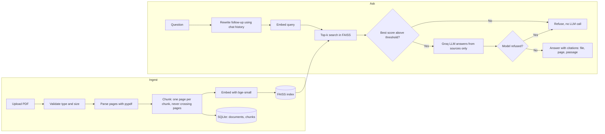

# DocuMind

Upload PDFs and ask questions in plain language. DocuMind finds the most relevant passages, answers using only those passages, and shows the **file name and page** behind every claim. If the answer is not in your documents, it says so instead of guessing.

**Live demo:** _add your Cloudflare Pages link here_

_Add screenshots here: chat with citations, a refused question, and the evaluation page._

## What it does

- Upload up to 10 PDFs at a time (10 MB each). Files are checked by content, and empty or scanned PDFs are rejected with a clear message.
- Answers stream in word by word, with numbered sources that expand to the full passage.
- Follow-up questions work ("What about part-time staff?") because they are rewritten into standalone questions before searching.
- Out-of-scope questions are refused, with no invented citations.
- A built-in evaluation measures retrieval quality, refusal behavior, and answer quality.

## Architecture



| Part | Technology |
|---|---|
| API | FastAPI, Pydantic, Uvicorn |
| PDF parsing | pypdf (page numbers kept) |
| Embeddings | fastembed, `BAAI/bge-small-en-v1.5` (CPU) |
| Vector search | FAISS (`IndexFlatIP` on normalized vectors, so cosine similarity) |
| LLM | Groq API, called with the official SDK |
| Storage | SQLite with SQLAlchemy |
| Frontend | React, Vite, Tailwind CSS |
| Tests | pytest |

No LangChain or LlamaIndex: the pipeline is a handful of small modules in `backend/app/services/`.

## Key design decisions

- **Custom pipeline instead of a framework.** Each step (`chunking`, `embeddings`, `vector_store`, `retriever`, `generator`, `memory`, `evaluator`) is short and testable, and every step can be explained in an interview.
- **Chunks never cross page boundaries.** Each chunk has exactly one page number, so a citation can say "page 2" and be right. Chunks are about 500 words with 80 words of overlap, and numbered clauses (like `2.1 ...`) are treated as paragraph breaks.
- **Two layers against made-up answers.** First, if the best match is below a similarity threshold, the LLM is never called. Second, the prompt tells the model to answer only from the numbered sources and to refuse otherwise. Refusals carry no citations.
- **A threshold per embedder.** Scores from the offline hashing fallback are much lower than bge-small scores, so each has its own default (0.15 and 0.45). Set `SCORE_THRESHOLD` to override, and tune it with the sweep below.
- **Retrieved text is treated as untrusted.** The prompt tells the model to ignore instructions that appear inside documents.
- **The server starts fast.** The embedding model loads in a background thread, `/api/health` reports `starting` until it is ready, and the UI shows a "waking up" message.
- **Free hosting friendly.** On startup, if the index or database is missing, the two PDFs in `sample_docs/` are indexed again so the demo always works.

## Evaluation

`backend/eval/test_set.json` has 28 questions over the two sample documents: 23 answerable (with the expected file and page) and 5 unanswerable. The evaluator builds its own in-memory index from `sample_docs/`, so results do not depend on what you uploaded.

| Metric | Meaning |
|---|---|
| Hit Rate@1 / @3 / @k | The expected file and page is ranked first / in the top 3 / in the top k |
| MRR | Mean reciprocal rank of the expected page |
| Correct refusal rate | Unanswerable questions that were refused |
| False refusal rate | Answerable questions that were wrongly refused |
| Judge correctness and faithfulness | 1 to 5 scores from an LLM judge (needs `GROQ_API_KEY`) |
| Average latency | Time per question |

```bash
cd backend
python eval/run_eval.py                  # uses Groq if GROQ_API_KEY is set
python eval/run_eval.py --no-llm         # retrieval and refusal only, no API calls
python eval/run_eval.py --sweep          # compare chunk sizes and thresholds
python eval/run_eval.py --chunk-words 200 --top-k 3 --threshold 0.5
```

Results are saved to `backend/eval/results/` and shown on the Evaluation page of the app.

### Your results with bge-small and the Groq judge

_Not run yet. Add `GROQ_API_KEY`, run `python eval/run_eval.py`, and paste the table from `eval/results/latest.md` here._

### Baseline: offline hashing embedder, retrieval only

This run used the offline fallback embedder (no model download) and no LLM, so it only checks the pipeline and shows how the threshold behaves. It is **not** a result for bge-small.

| chunk_words | threshold | Hit@1 | MRR | Correct refusals | False refusals |
|---|---|---|---|---|---|
| 100 | 0.10 | 1.00 | 1.00 | 0.80 | 0.00 |
| 100 | 0.15 | 1.00 | 1.00 | 1.00 | 0.09 |
| 100 | 0.20 | 1.00 | 1.00 | 1.00 | 0.26 |
| 200 | 0.10 | 1.00 | 1.00 | 0.80 | 0.00 |
| 200 | 0.15 | 1.00 | 1.00 | 1.00 | 0.22 |
| 200 | 0.20 | 1.00 | 1.00 | 1.00 | 0.35 |
| 500 | 0.10 | 1.00 | 1.00 | 0.80 | 0.00 |
| 500 | 0.15 | 1.00 | 1.00 | 1.00 | 0.22 |
| 500 | 0.20 | 1.00 | 1.00 | 1.00 | 0.35 |

What it shows: the sample set is small (7 pages), so hit rates are saturated. The useful signal is the threshold trade-off: a lower threshold stops wrongly refusing real questions but starts letting out-of-scope ones through. Smaller chunks reduced false refusals at the same threshold. Run the same sweep with bge-small and record what you find.

## Run it locally

You need Python 3.12 and Node 20+.

```bash
# Backend
cd backend
python -m venv .venv && source .venv/bin/activate     # Windows: .venv\Scripts\activate
pip install -r requirements-dev.txt
cp .env.example .env                                   # then add your GROQ_API_KEY
uvicorn app.main:app --reload --port 8000

# Frontend (second terminal)
cd frontend
npm install
cp .env.example .env                                   # VITE_API_URL=http://localhost:8000
npm run dev                                            # http://localhost:5173
```

The first start downloads the embedding model (about 130 MB). If it cannot be downloaded, the app falls back to the offline hashing embedder and logs an error; answers still work but retrieval is weaker.

### Environment variables (backend)

| Variable | Default | Purpose |
|---|---|---|
| `GROQ_API_KEY` | none | Required for answers. Free key at console.groq.com |
| `GROQ_MODEL` | `llama-3.3-70b-versatile` | Model used for answers, rewriting, and judging |
| `ALLOWED_ORIGINS` | `http://localhost:5173` | Comma-separated frontend URLs allowed by CORS |
| `TOP_K` | 5 | Passages retrieved per question |
| `SCORE_THRESHOLD` | per embedder | Minimum similarity to answer at all |
| `CHUNK_WORDS` / `CHUNK_OVERLAP` | 500 / 80 | Chunk size and overlap, in words |
| `MAX_UPLOAD_MB` | 10 | Per-file upload limit |
| `EMBEDDING_BACKEND` | `fastembed` | `fastembed` or `hashing` (offline) |

## Tests

```bash
cd backend && pytest -q
```

21 tests cover chunking (page boundaries, overlap), retrieval (a known question finds the right chunk), refusal logic, upload validation, citations, follow-up rewriting, streaming, rate limiting, and the evaluation. The LLM is replaced by a fake, and tests use the offline embedder, so they need no network or API key.

## Deploy

**Backend on Render (free plan)**

1. Push this repo to GitHub. In Render, choose New, then Blueprint, and select the repo. It reads `render.yaml` and builds `backend/Dockerfile`, which includes the embedding model so cold starts do not download it.
2. Set `GROQ_API_KEY` and `ALLOWED_ORIGINS` (your Cloudflare URL) in the Render dashboard.
3. Without Docker: root directory `backend`, build `pip install -r requirements.txt`, start `uvicorn app.main:app --host 0.0.0.0 --port $PORT --proxy-headers --forwarded-allow-ips="*"`.

The free disk is temporary: uploads and chats reset when the service restarts, and the demo index is rebuilt from `sample_docs/`. The free plan also sleeps when idle, and the UI shows a "waking up" message.

**Frontend on Cloudflare Pages**

1. Create a Pages project from the same repo.
2. Root directory `frontend`, build command `npm run build`, output directory `dist`.
3. Add the environment variable `VITE_API_URL` set to your Render URL, then redeploy.

## API

| Method | Path | Purpose |
|---|---|---|
| POST | `/api/documents/upload` | Upload PDFs (multipart field `files`), one result per file |
| GET | `/api/documents` | List documents |
| DELETE | `/api/documents/{id}` | Remove a document and its passages |
| POST | `/api/chat/new` | Start a chat session |
| POST | `/api/chat` | Ask a question, get answer, citations, `grounded`, `latency_ms` |
| POST | `/api/chat/stream` | Same, as Server-Sent Events (`meta`, `token`, `done`, `error`) |
| GET | `/api/chat/{session_id}` | Chat history |
| POST | `/api/eval/run` | Run the evaluation |
| GET | `/api/eval/latest` | Latest evaluation result |
| GET | `/api/health` | Status (`starting`, `ok`, `error`) |

## Limitations and future work

- Scanned or image-only PDFs are rejected. Adding OCR would fix this.
- Search is vector-only. Hybrid BM25 plus vector search and a reranker would help exact terms such as names and numbers.
- No user accounts: all uploaded documents are shared by everyone using the same server. Add authentication and per-user indexes before using it with private files.
- Chunking relies on numbered clauses and blank lines, so heavily formatted layouts (tables, multi-column pages) can split poorly.
- The rate limiter and chat sessions live in one process, so they would need Redis or a database to run on several instances.
- The evaluation set is small and written for the sample documents. Add your own questions to `backend/eval/test_set.json`.
